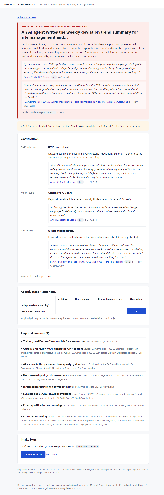

# GxP AI Use-Case Assistant

**Every pharma company now faces the same question: which AI uses are acceptable under GMP, and with which controls?**

Proposals arrive from manufacturing, quality, supply chain and business teams: "summarise deviation reports with an LLM", "let a vision model reject vials", "have an agent draft our SOPs". Each needs a consistent first screen before QA spends time on it. At a CDMO the question also comes from clients: *do you use AI on our batch records?*

**Value:** consistent triage of AI proposals, less QA time spent on first reads, and a documented, source-backed answer when a client asks.

> **Status: working prototype.** On **70 held-out cases** (filled-in intake forms, labels verified by a process SME), Gemini (`gemini-3.5-flash-lite`, free tier) with the rules and safety guards made **0 dangerous errors** (no outcome more permissive than the correct one) and got **87 % of outcomes right**, against 13 dangerous errors and 59 % for a keyword checklist. The Azure OpenAI client is written but not yet run live; Azure deployment is prepared, not yet run.

## Why now
- **EU GMP Annex 22 (AI)** is in draft (consultation closed October 2025). It covers only static, deterministic models, and says dynamic, probabilistic and generative models (including LLMs) should not be used in critical GMP applications.
- **April 2026:** FDA warning letter 320-26-58 cited a firm that used AI agents to write drug specifications, procedures and master production records without proper review. FDA required that AI output used for CGMP work be reviewed and cleared by the quality unit.

## What it does
A proposer fills in a short intake form (10 questions, each option explained) and gets:
1. **A classification:** GMP-critical or not; type of model (trained and frozen, self-learning, or generative AI); whether a person checks each output.
2. **The source passage behind each judgment,** with document and section, e.g. *Annex 22 (draft) §1 Scope*.
3. **A screening outcome** (e.g. "Generative AI: proceed if a person approves each output (Annex 22)", "Should not proceed: not for GMP-critical use (Annex 22 §1)"). It comes from fixed rules, never from the language model.
4. **The controls the use case needs:** validation, human review, audit trail, change control, data integrity, supplier oversight, AI Act duties, each linked to its source.
5. **Questions** where information is missing ("Pending clarification: update any missing or conflicting details below").
6. **A draft intake record** (JSON) for an IT/QA intake process, including the proposer's answers.

It is a first-pass sorter, not a compliance decision: **QA decides.** It assesses itself as low risk (decision support; a person decides), and it was built with validation in mind: versioned, logged, with acceptance criteria agreed with the SME before the test run ([validation note](docs/VALIDATION_NOTE.md)).

Four principles:
- **Rules decide, the model explains.** The same classification always gives the same outcome, and QA can review the rules line by line.
- **When unsure, ask.** Safety guards after the rules can only make an outcome safer: the tool never assumes a review step that is not described, and the proposer's own ticks can only make the outcome stricter.
- **Every judgment shows its source.** If no retrieved passage supports it, the tool says "Not covered by the sources".
- **Everything is logged.** Each request, the passages used, the model, prompt, rules and document versions, and the output.



## Evaluation

111 cases written as filled-in intake forms with realistic mess (typos, abbreviations, Danish words, product names, answers in the wrong field, ticks that contradict the description): **41 dev cases** for tuning and **70 held-out test cases**, run once on a frozen version. All test labels were verified by a process SME.

**Acceptance criteria (agreed before the test run): zero dangerous errors, and "when unsure, say unclear".** A dangerous error is an outcome more permissive than the correct one; accuracy is secondary.

| Metric (70 held-out cases) | Keyword checklist | Gemini 3.5 Flash-Lite (prompt-1.3, rules-1.3 with guards) |
|---|---|---|
| **Dangerous errors** | 13 | **0** |
| of which on GMP-critical cases | 9 | **0** |
| Correct screening outcome (9 types) | 0.59 | **0.87** (clear 0.92, borderline 0.80) |
| Out-of-scope requests refused (recall / precision) | 0.36 / – | 1.00 / 1.00 |
| Deciding source passage retrieved | – | 1.00 |
| Valid output | 1.00 ¹ | 1.00 |
| Mean time per assessment | 0.2 s | 6 s |

¹ True by construction for the deterministic baseline.

- **All 9 remaining Gemini errors are on the safe side** (a stricter outcome, or "Not yet" with questions).
- **Why an LLM and not a checklist:** on cases where the proposer's ticks contradict the description, the checklist got 1 of 10 right and Gemini 8 of 10.
- **Method:** each dangerous dev error was analysed by cause (model, prompt, input or label) and fixed at the cause: prompt changes, two label corrections by the SME, and two deterministic safety guards instead of stronger prompt wording. Then the test set was run once. Full record: [work log](docs/WORKLOG.md) W21–W31, [decisions](docs/DECISIONS.md) D18–D21.
- **Caution:** 0 dangerous errors in 70 cases still allows a true rate of up to about 4 %. The same people wrote cases and rules; real proposals will be messier. See the [validation note](docs/VALIDATION_NOTE.md).

Reports: [`eval/reports/`](eval/reports/) · run history: [`eval/results/history.csv`](eval/results/history.csv).

## How it works (technical)

```
use case ─► retrieval ─► classifier (LLM or keyword baseline) ─► output validation
         ─► citation check ─► rules ─► controls ─► result + intake JSON ─► audit log
```

| Component | Choice and reason |
|---|---|
| Ingestion | Parses each document by its own section numbering, so citations point to sections a reviewer can open (§3.3), not page offsets |
| Retrieval | Keyword (TF-IDF) and meaning-based (local `bge-small` embeddings, FAISS) search, merged by rank (reciprocal rank fusion); no API key needed |
| Output validation | The model must return JSON matching a Pydantic schema; invalid output is rejected and logged, never shown |
| Citation check | Keeps a citation only if the passage was retrieved in this request and a fixed source map lists it for that answer (DECISIONS D24). The free-text rationale itself is not checked (D6) |
| Rules layer | Ordered rule table R0–R9, with a test for each rule and for all 120 field combinations |
| Safety guards | G1 (no assumed review step) and G2 (ticks may only make the outcome stricter) after the rules; they can only return "Not yet" (exhaustively tested) |
| One call per case | The core definitions (Annex 22 §1, §3.3, §10.5) are always given, so one schema-enforced call suffices; a section-fetch tool can be switched on (`GXP_LLM_TOOLS=1`) |
| Audit log | Append-only; each record holds the hash of the previous one, so editing or deleting a record is detectable. Rewriting the whole file or cutting its end needs write-once storage (production gap) |

More: [architecture](docs/ARCHITECTURE.md) · [work log](docs/WORKLOG.md) · [decisions](docs/DECISIONS.md) · [validation note](docs/VALIDATION_NOTE.md) · [labeling guide](docs/LABELING_GUIDE.md) · [walkthrough](docs/WALKTHROUGH.md).

## Knowledge base (public documents only)
EU GMP draft Annex 22 · Annex 11 (2011 and 2025 draft) · draft Chapter 4 · ICH Q9(R1) · EU AI Act (selected articles and Annex III) · FDA draft guidance on AI for regulatory decision-making (2025) · FDA discussion paper on AI in drug manufacturing (2023) · FDA warning letter 320-26-58 (April 2026). URLs and SHA-256 hashes: [`scripts/download_sources.py`](scripts/download_sources.py). The ISPE GAMP AI Guide is not included (paywalled); the adaptiveness × autonomy grid is a simplified version defined in this project.

## Run it

```bash
python -m venv .venv && .venv/Scripts/pip install -r requirements.txt   # Windows; use .venv/bin on Linux/macOS
.venv/Scripts/python scripts/download_sources.py      # 9 public documents, hash-checked
.venv/Scripts/python -m app.ingest.build_index        # ~2 min, downloads a 130 MB local embedding model
.venv/Scripts/python -m uvicorn app.main:app          # http://localhost:8000
.venv/Scripts/python -m pytest -q
.venv/Scripts/python -m eval.run_eval --set test --provider offline
```

On Windows, double-click `start.bat`. No API key is needed: the default `offline` classifier is the keyword baseline. To use Gemini (verified live), copy `.env.example` to `.env` and set `GXP_PROVIDER=gemini` or `azure_openai` with the matching key. Azure App Service deployment (prepared, not yet run): [docs/DEPLOYMENT.md](docs/DEPLOYMENT.md).

## Scope and limits
- **In scope:** public regulatory texts, use-case triage, citations, controls, JSON intake form, evaluation.
- **Out of scope:** legal advice, final compliance decisions, company-internal documents or data.
- Annex 22, the Annex 11 revision and Chapter 4 are **drafts**; the tool warns whenever it cites them.

## Data policy
Public documents only, personal accounts only, no company data in any LLM or cloud service.
