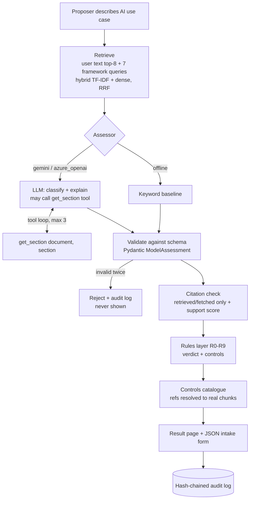
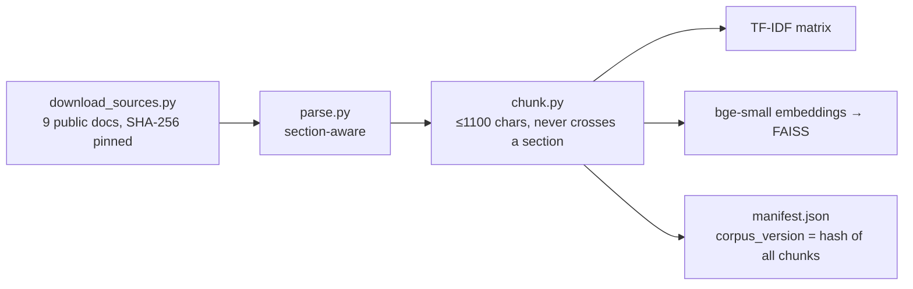

# Architecture

## Request flow

## Offline build

## Modules

| Module | Responsibility |
|---|---|
| `app/ingest/sources.py` | Manifest: id, title, status (draft/in force), URL, parser config for each document |
| `app/ingest/parse.py` | PDF/text → sections with the document's own ids |
| `app/ingest/chunk.py` | Sections → chunks `doc:section:n` |
| `app/ingest/build_index.py` | Builds TF-IDF, embeddings, FAISS, manifest |
| `app/retrieval/index.py` | Hybrid search, `get_section`, similarity for the citation check |
| `app/assessors/` | `offline.py` (keywords), `llm.py` (tool loop + schema-forced answer) |
| `app/llm/` | `ChatClient` interface, Gemini/Azure clients, prompt (versioned), fake client |
| `app/schema.py` | Pydantic models: assessor output, result, intake form |
| `app/citations.py` | Citation check and quote extraction |
| `app/source_map.py` | Which paragraphs may back each answer, and where each quote starts/stops so a classification source shows its definition only (used by the prompt, retrieval, the citation check and the eval; D24, D26) |
| `app/rules.py` | Deterministic verdicts and control selection |
| `app/guards.py` | Safety guards after the rules (form input): can only turn an outcome into "Pending clarification" (G1 review not stated; G1b receiving is not a check; G2 ticks stricter than the model, with the contradiction explained) |
| `app/safety.py` | Strict-to-permissive ranking of outcomes and the dangerous-error rule (used by the guards and the evaluation) |
| `app/controls.py` | Controls catalogue with (doc, section) references |
| `app/tools.py` | `get_section` tool with call log and limit |
| `app/audit.py` | Append-only hash-chained audit log |
| `app/pipeline.py` | Orchestration |
| `app/main.py` | FastAPI: landing, form, result page, follow-up rounds, source pages, How it works, JSON API, intake download, health, audit verify; the assessment runs in a worker thread |
| `app/section_page.py` | A regulatory section as a readable page, with the cited passage highlighted (`/section`) |
| `app/how_it_works.py` | The process flow and decision tree for `/how-it-works`, built from the rules (a test checks every leaf against `decide()`) |
| `eval/run_eval.py` | Metrics, stored results per version, regression history |

## Trust boundaries
- **User text** is data: the prompt wraps it in delimiters and tells the model not to follow instructions inside it. The rules layer means a prompt injection can at worst produce a wrong *classification*, not an arbitrary verdict or control list.
- **Model output** is untrusted until validated, and citations are untrusted until checked.
- **Sources** are pinned by hash. A changed document fails the download check.

## Scaling notes (what would change in a company setting)
- Corpus: add internal SOPs and policies → access control per document, and Azure AI Search with security trimming instead of a local FAISS file.
- Audit log → write-once storage (immutable Blob) or a database table with append-only permissions.
- Identity: Entra ID login, so audit records are attributable to a named user.
- Intake form → posted to the actual intake system (ServiceNow, Power Automate) instead of downloaded.
